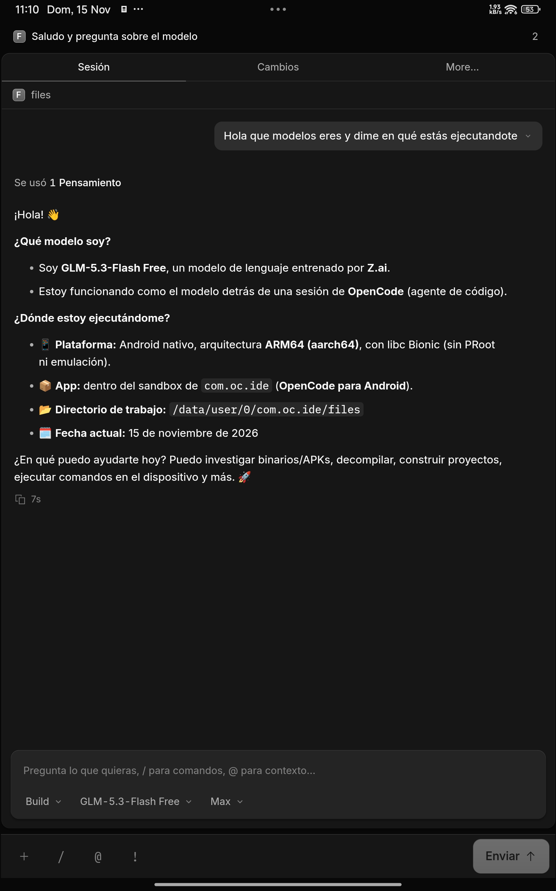
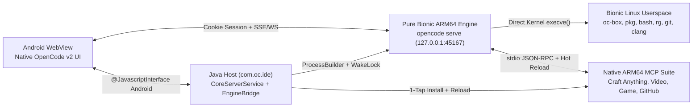
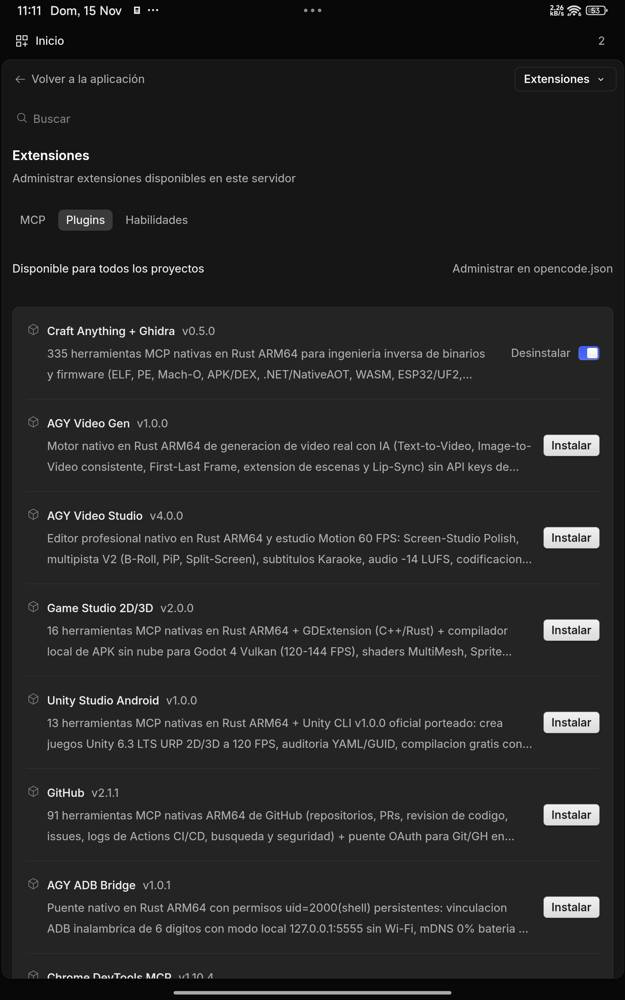
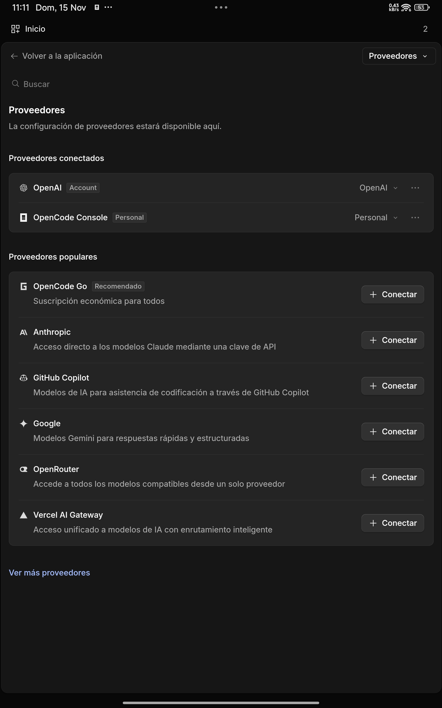
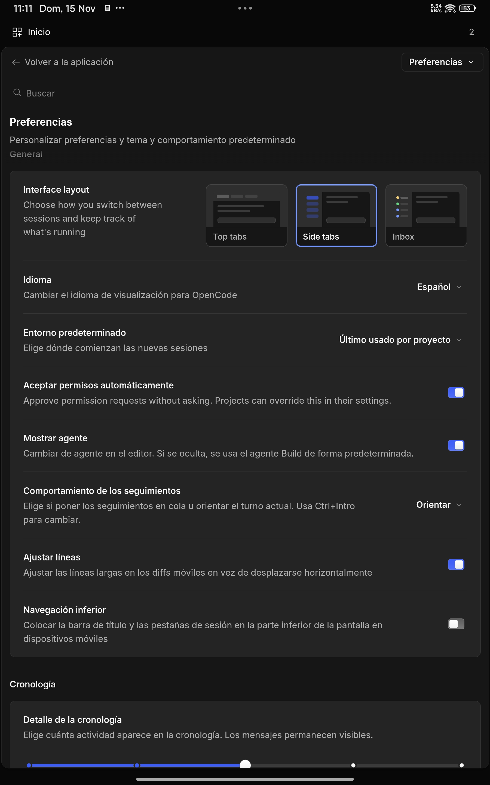
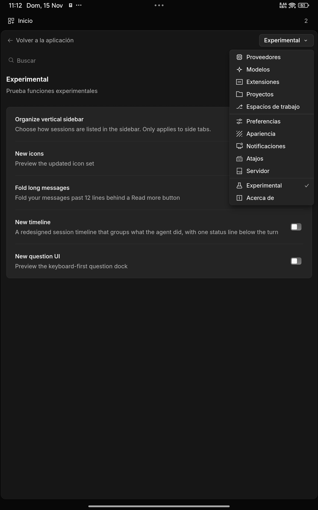

<div align="center">

  <br/>

  

  <h1 align="center">OpenCode for Android</h1>

  <p><font color="#7d8590">Standalone <b>OpenCode v2.3.0</b> autonomous coding IDE &amp; native <b>Pure Android Bionic ARM64</b> APK — engineered by <a href="https://github.com/Yhoanes"><b>Yhoanes</b></a> (zero PRoot, zero Glibc shim, zero Termux dependency).</font></p>

  <p>
    <code>v2.3.0-r4</code> &nbsp;&bull;&nbsp;
    <code>Android 9.0+ (API 28+)</code> &nbsp;&bull;&nbsp;
    <code>Pure Bionic /system/bin/linker64</code> &nbsp;&bull;&nbsp;
    <code>Native Rust opencode-pty v8 + oc-box</code> &nbsp;&bull;&nbsp;
    <code>Native Extensions &amp; MCP Hub</code> &nbsp;&bull;&nbsp;
    <code>Craft Anything + Ghidra 12.1.4</code> &nbsp;&bull;&nbsp;
    <code>Shizuku (rish) + 1-Tap OTA</code>
  </p>

  <br/>

  

</div>

<br/>

---

## Architectural Overview

**OpenCode for Android (`v2.3.0-r4`)** brings the full **OpenCode v2** autonomous software engineering engine and responsive Workbench UI directly to Android phones and tablets as a standalone native APK (`com.oc.ide`).

Unlike containerized `proot-distro` wrappers, remote SSH clients, or heavy `glibc` compatibility layers, **OpenCode for Android** executes **100% Pure Android Bionic** (`ELF 64-bit LSB pie executable, ARM aarch64`, dynamically linked directly against `/system/bin/linker64`, `libc.so`, `libm.so`, and `libdl.so`). Every agent tool execution, `ripgrep` code search, interactive terminal session, `pkg` package installation, and native Rust MCP server runs directly on mobile silicon at physical UFS storage speeds.

> [!IMPORTANT]
> **10-Byte Native Prefix Parity (`com.oc.ide` == `com.termux`):** By engineering a 10-character Android application ID (`com.oc.ide` for release, `com.oc.dev` for side-by-side dev builds), the embedded Linux userspace (`/data/user/0/com.oc.ide/files/usr`) maintains exact byte-length parity with standard Bionic packages — enabling native `execve()` execution of `clang`, `rust`, `python`, `nodejs`, `git`, `ghidra`, and `openjdk-21` with **zero `PRoot` overhead**.



---

## Core Engineering Pillars

| Subsystem | Technical Implementation |
| :--- | :--- |
| **Pure Bionic `v2.3.0` Engine** | Native ARM64 single-binary server (`opencode serve --service`), supporting **75+ AI providers**, multi-session workspaces, live file diffs, LSP diagnostics, subagents, and custom slash commands without emulation. |
| **Zero-Friction Session Handshake** | `OnboardingSeeder` provisions `service-stable.json`; `CoreProcessSupervisor` verifies `/api/info`, exchanges `POST /api/pair` &rarr; `GET /auth/connect/:code` for a 30-day session cookie (`opencode_session_45167`), and injects it into `CookieManager` prior to first paint (`<200 ms` splash-to-ready). |
| **Native `Extensions → Plugins` Hub** | Zero foreign floating overlays. Native ARM64 plugins mount directly inside OpenCode's native **Settings &rarr; Extensions &rarr; Plugins** catalog, sync `opencode.json` (`mcp` + `skills.paths`), and trigger `POST /api/location/reload` for instant zero-restart hot-reloading. |
| **Native Rust `opencode-pty` (`v8`) & `oc-box`** | Pure Bionic ARM64 `opencode-pty` Protocol v8 persistent PTY & pipe daemon (`2 MiB` ring replay, zero-loss handoff) paired with `oc-box` (`v0.3.0`) 4-thread parallel `pkg`, `oc-daemon`, SIMD `oc-fix-paths`, and native `oc-notify` status-bar alerts. |
| **Native Android Folder Picker** | Seamless project selection from any directory on shared device storage (`/storage/emulated/0/...`): combines Android's native system **File Manager** folder picker (`Intent.ACTION_OPEN_DOCUMENT_TREE`, supporting creating new folders directly) with an SELinux virtual-root bridge for OpenCode's directory browser. |
| **Mobile Lifecycle & 1-Tap OTA** | Automatic SSE/WebSocket background-resume recovery (`oc:host-resume`), Workbox ServiceWorker cache neutralization, OAuth Chrome Custom Tabs (`xdg-open`), Shizuku (`rish`), and live GitHub Releases OTA updates inside **Settings &rarr; About**. |

---

## Visual Walkthrough

### 1. Native `Extensions → Plugins` ARM64 Ecosystem
Install, toggle, or uninstall compiled **Android ARM64 Rust MCP servers and skills** directly from **Settings &rarr; Extensions &rarr; Plugins** — using OpenCode's native catalog components with instant hot-reload into the **MCP** and **Skills** tabs:

<p align="center">
   Plugins Catalog in OpenCode for Android" width="100%" />
</p>

| Native ARM64 Plugin | Version | Capabilities on Android |
| :--- | :---: | :--- |
| **Craft Anything + Ghidra** | `v0.5.0` | **335 native Rust MCP tools** (`<50 MB` RAM) for ELF/PE/Mach-O, APK/DEX, `.NET`/NativeAOT, WASM, ESP32/UF2, Godot `.pck`, Unity IL2CPP & GameCube/Wii `.dol` + on-demand native ARM64 **Ghidra 12.1.4** (`craft-ghidra-setup`). |
| **AGY Video Gen** | `v1.0.0` | Native Rust AI video diffusion engine (`videogen_create`, `videogen_bridge`, `videogen_extend`, `videogen_upscale`) generating real moving `.mp4` clips with CAS GPU super-resolution. |
| **AGY Video Studio** | `v4.0.0` | Pro 60 FPS Motion Design & Screen-Studio video editor with `h264_mediacodec` hardware encoding, multi-track `V2` B-Roll, `-14 LUFS` audio mastering, and Karaoke captions. |
| **Game Studio 2D/3D** | `v2.0.0` | 16 native Rust MCP tools + `GDExtension` (`C++`/`Rust`) compiler + 100% local offline signed `.apk` builder and 120–144 FPS profiler for **Godot 4 Vulkan**. |
| **Unity Studio Android** | `v1.0.0` | 13 native Rust MCP tools + ported **Unity CLI `v1.0.0`** for Unity 6.3 LTS URP 2D/3D scaffolding, deterministic `.meta`/YAML auditing, `$0` GameCI builds, and live `rish` debugging. |
| **GitHub MCP** | `v2.1.1` | 91 native ARM64 GitHub tools (repositories, PRs, code reviews, Issues, Actions CI/CD logs, security alerts) + native Bionic OAuth setup (`16 KB`-aligned `libagy-go-dns.so`). |
| **AGY ADB Bridge** | `v1.0.1` | Persistent `uid=2000(shell)` wireless ADB 6-digit pairing (`127.0.0.1:5555` offline TCP mode), zero-polling mDNS discovery, and 2-second watchdog fallback to Shizuku `rish`. |
| **Chrome DevTools MCP** | `v1.10.4` | Headless native ARM64 Chromium automation via Chrome DevTools Protocol (DOM snapshots, network inspection, screenshots, and JS evaluation). |
| **Android CLI & Science Suite** | `v1.0+` | On-device APK/DEX inspection, `logcat`/`dumpsys` telemetry, plus native ARM64 scientific computing (`numpy`, `scipy`, `sympy`, `pandas`, `matplotlib`). |

---

### 2. Multi-Provider AI Hub & Adaptive Mobile/Tablet UX
Connect **OpenAI**, **OpenCode Console / Go**, **Anthropic (Claude)**, **GitHub Copilot**, **Google Gemini**, **OpenRouter**, **Vercel AI Gateway**, **DeepSeek**, **Z.ai**, or local **Ollama** endpoints — and customize workspace layouts (`Top tabs`, `Side tabs`, `Inbox`), mobile diff line-wrapping, auto-permissions, and bottom navigation:

<p align="center">
  
  
</p>

---

### 3. Complete Settings Control & Experimental Features
Full parity with OpenCode v2's settings architecture — **Providers**, **Models**, **Extensions**, **Projects**, **Workspaces**, **Preferences**, **Appearance**, **Notifications**, **Shortcuts**, **Server**, **Experimental**, and **About** (including in-app OTA update checks):

<p align="center">
  
</p>

---

## System Requirements

| Component | Minimum | Recommended |
| :--- | :--- | :--- |
| **OS Version** | Android 9.0 Pie (`API 28`) | Android 12 – 16+ |
| **CPU Architecture** | `arm64-v8a` (`aarch64`) | Snapdragon 8 Gen 1+ / Tensor G2+ / Dimensity 9000+ |
| **Memory (RAM)** | `4 GB` | `8 GB – 16 GB` (especially when running Ghidra 12.1.4 or Chromium) |
| **Free Storage** | `1.0 GB` (Base IDE + Bionic bootstrap) | `4 GB+` (for `clang`, `rust`, `nodejs`, `openjdk-21`, and Ghidra) |
| **Root Access** | **Not Required** | Optional **Shizuku (`rish`)** / **AGY ADB Bridge** for `uid=2000(shell)` |

---

## Installation & Building From Source

### Option A — Install Prebuilt Signed APK
1. Download the latest `OpenCode-v2.3.0-r4.apk` from [**GitHub Releases**](https://github.com/Yhoanes/opencode-android/releases).
2. Install directly on your Android device (or via `adb` / `rish`):
   ```bash
   # Via ADB from PC:
   adb install -r OpenCode-v2.3.0-r4.apk

   # Or on-device via Shizuku:
   rish -c "pm install -r /sdcard/Download/OpenCode-v2.3.0-r4.apk"
   ```

### Option B — Gradle-Free Deterministic Build Pipeline
**OpenCode for Android** compiles end-to-end **without Gradle or Android Studio** — on Linux (`x86_64`/`aarch64`) or **directly on-device inside Android** using `aapt`, `javac` (JDK 17/21), `d8` (`r8.jar`), `zipalign`, and `apksigner`:

```bash
git clone https://github.com/Yhoanes/opencode-android.git
cd opencode-android

# Standard Release APK -> dist/OpenCode-v2.3.0-r4.apk (package: com.oc.ide, port: 45167)
bash build.sh

# Side-by-Side Dev APK -> dist/OpenCode-Dev-v2.3.0-r4.apk (package: com.oc.dev, port: 45168)
bash build.sh --dev
```

---

## Frequently Asked Questions

**Does OpenCode for Android use PRoot, Termux, or a virtual machine?**  
No. It runs **100% natively in Android userspace** using Android's system `/system/bin/linker64` and Bionic `libc.so` inside its own standalone sandbox (`com.oc.ide`). You do not need Termux installed, and there is zero syscall translation overhead.

**Does it require Root?**  
No. Everything works out of the box on unrooted Android 9.0+ phones and tablets. Connecting optional **Shizuku (`rish`)** or the **AGY ADB Bridge** plugin unlocks elevated `uid=2000(shell)` capabilities such as silent 1-tap APK installation, `logcat` diagnostics, and on-device game profiling.

**Can I install compilers, Python, Node.js, Rust, or Ghidra inside OpenCode?**  
Yes. Open the integrated terminal or ask the agent directly to run `pkg update && pkg install git python nodejs clang rust ripgrep jq`, or install **Craft Anything + Ghidra (`v0.5.0`)** from **Settings &rarr; Extensions &rarr; Plugins** and run `craft-ghidra-setup` for native ARM64 Ghidra `12.1.4` decompilation.

---

## Repository Structure

```text
opencode-android/
├── app/src/main/     # Pure-Java Android Host (com.oc.ide), ForegroundService, Auth & EngineBridge
├── build.sh          # Deterministic 11-phase Gradle-free APK build orchestrator
├── build/            # Modular build phases (00-dev .. 09b-verify) & BuildConfig generator
├── config/           # Centralized app identity, SDK flags & default Android AGENTS.md rules
├── core/             # Compressed Pure Bionic ARM64 OpenCode core archive, TLS certs & Shizuku rish
├── dist/             # Output directory for signed release & dev APKs
├── docs/             # Architecture specification (ARCHITECTURE.md) & high-res visual assets
├── env/              # Bionic Linux bootstrap, native Rust oc-box v0.3.0 source/binary & pkg manager
├── tools/            # Self-contained android.jar, r8.jar (D8), and signing keystore
└── web/              # Native Extensions/About runtime script (__oc_android_boot.js) & MCP catalog
```

---

## License, Copyright & Attribution Terms

**Copyright &copy; 2026 [Yhoanes](https://github.com/Yhoanes)** — All rights reserved over the architecture, host runtime, native Rust `oc-box` engine, extensions integration, documentation, visual assets, and compiled APK distributions.

Pursuant to **Section 4 of the Apache License, Version 2.0**, **OpenCode for Android** is licensed under the **Non-Commercial &amp; Mandatory Attribution License (`BY-NC`)** (see [`LICENSE`](LICENSE) and [`NOTICE`](NOTICE)):

* **Mandatory Attribution (`BY`):** Any fork, redistribution, modified version, or binary/APK distribution **must** retain the [`LICENSE`](LICENSE) and [`NOTICE`](NOTICE) files intact, prominently credit **Yhoanes** as the creator and author of **OpenCode for Android**, and include a visible link back to [https://github.com/Yhoanes/opencode-android](https://github.com/Yhoanes/opencode-android).
* **Strict Non-Commercial Use Only (`NC`):** Commercial sale, paid redistribution, commercial hardware/software bundling, or commercial monetization of this software, derivatives, or its compiled APK binaries is **strictly prohibited** without prior written authorization from **Yhoanes**.

<div align="center">
  <p><font color="#7d8590">Copyright &copy; 2026 <a href="https://github.com/Yhoanes">Yhoanes</a> &nbsp;&bull;&nbsp; <a href="LICENSE">Non-Commercial &amp; Mandatory Attribution License</a></font></p>
</div>
