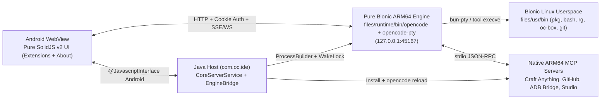

# OpenCode for Android — Architecture Specification (`v2.3.0-r4`)

## 1. Execution Model: Pure Bionic (`Zero PRoot`, `Zero Glibc`)

1. **`targetSdkVersion="28"` & `minSdkVersion="28"`:** Android 10–16+ enforces `W^X` SELinux restrictions on `app_data_file` executables only for apps targeting API >= 29. Keeping `targetSdkVersion="28"` allows direct kernel `execve()` of `/data/user/0/com.oc.ide/files/runtime/bin/opencode` and `/data/user/0/com.oc.ide/files/usr/bin/*` at native hardware speed.
2. **10-Byte Package Identifier (`com.oc.ide` / `com.oc.dev`):** Matches `com.termux` (`10` ASCII bytes) so precompiled Termux Bionic `.deb` packages run natively after `oc-box` / `pkg` in-RAM prefix rewriting without `PRoot`.

---

## 2. Startup, Pairing & Cookie Handshake

1. **`CoreInstaller` + `ManifestVerifier`:** Extracts `assets/runtime` into `files/runtime/`, verifies every file against `assets/runtime/manifest.json` (`SHA-256`), and extracts `assets/web` into `files/web/`.
2. **`EnvInstaller`:** Unpacks `assets/env/bootstrap/bootstrap.tar.gz` into `files/usr/`, overlays `oc-box`, `rg`, `pkg`, and profile scripts, and fixes shebangs/symlinks.
3. **`OnboardingSeeder`:** Writes `$HOME/.config/opencode/service-stable.json` (`{"hostname":"127.0.0.1","port":45167,"password":"<csrfToken>"}`), `$HOME/.config/opencode/opencode.json` (`$schema` + Android `AGENTS.md` instructions), and default workspace `/storage/emulated/0/Documents/OpenCode/AGENTS.md`.
4. **`CoreProcessSupervisor` + `CoreReadyProbe`:** Launches `opencode serve --service --hostname 127.0.0.1 --port 45167`, polls `GET /api/info` with HTTP Basic Auth (`opencode:<csrfToken>`), then calls `POST /api/pair` (`{"name":"OpenCode Android"}`) + `GET /auth/connect/:code` to mint a 30-day `opencode_session_45167` cookie token.
5. **`AppLoader` + `LocalAssetServer`:** Writes `opencode_session_45167` into Android `CookieManager`, loads `http://127.0.0.1:45167/`, intercepts HTML root document responses in `AgyWebViewClient.shouldInterceptRequest()` to inject ``, and dismisses the native splash overlay once SolidJS mounts `#root`.

---

## 3. Native Extensions (`Plugins` / `MCP` / `Skills`) & Hot-Reload

When a user installs or toggles a plugin inside OpenCode's native **`Settings → Extensions → Plugins`** tab:
1. `EngineBridge.installMarketplacePlugin()` downloads `plugins/<name>/<name>.zip` from `Yhoanes/antigravity-android-plugins`.
2. Unpacks into `$HOME/.config/opencode/plugins-hub/<name>/`, sets `0755` permissions on native ARM64 binaries, and rewrites `/data/user/0/com.agy/files` paths to `/data/user/0/com.oc.ide/files`.
3. Syncs `SKILL.md` directories into `$HOME/.config/opencode/skills/`, `rules/*.md` into `$HOME/.config/opencode/rules/`, and `mcp.servers.<serverName>` + `skills.paths` into `$HOME/.config/opencode/opencode.json`.
4. Invokes `POST /api/location/reload` so the running OpenCode v2 server hot-reloads MCP servers and Skills in `<100 ms` over SSE without restarting the server or dropping active terminals.
